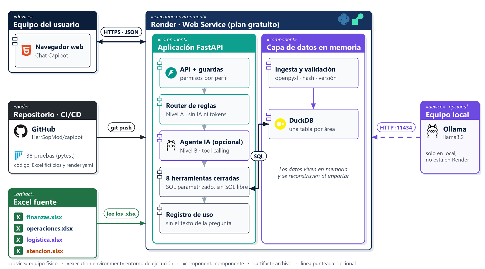

# Capibot — consulta integrada de Excel (POC académica)

> **ENTORNO DEMO — DATOS FICTICIOS.** Prueba de concepto universitaria. No es un sistema productivo ni debe usarse con datos reales.

La demo carga diez áreas desde Excel: Finanzas, Operaciones, Logística, Atención, Fiscalización, Recaudación, Notificaciones, Impugnaciones, Convenios y Documentos. Las seis últimas son fuentes adicionales sintéticas enlazadas por identificadores ficticios; no representan los sistemas reales de una entidad de multas. La app responde preguntas en español y **cita archivo, hoja y fila** de cada dato. Los archivos fuente originales no se modifican.

## Qué es (y qué no es)

| Nivel | Estado | Cómo se llama honestamente |
|---|---|---|
| **A — Consultas por reglas** (por defecto) | Implementado y probado | Consulta conversacional por reglas. **No es un agente de IA.** Sin tokens, sin clave, sin internet. |
| **B — Agente IA con tool calling** (opcional) | Implementado; probado con un modelo simulado y con `llama3.2` (3B) vía Ollama | Funciones cerradas + validación + trazas. Con el modelo real, 2 de 3 preguntas de prueba usaron el agente; en la otra el modelo escribió mal un argumento, la validación lo rechazó y se respondió por reglas. Es una prueba puntual, no una medición de exactitud. Latencia observada: 10–22 s por consulta en esta máquina. |

La interfaz muestra siempre el modo activo («Consultas por reglas» o «Agente IA»). Mientras no se valide el Nivel B con un modelo real, describe el entregable como *«POC de integración y consulta conversacional preparada para IA»*.

## Diagrama de despliegue



El navegador consulta por HTTPS a la aplicación FastAPI (en Render o en local), que lee los Excel/CSV, los carga en DuckDB y responde con herramientas cerradas. Los archivos nuevos se almacenan separados de las fuentes originales. GitHub redespliega en cada push a `main`; Ollama es opcional y solo local. Logotipos: Simple Icons (Python, FastAPI, DuckDB, HTML5, JavaScript, GitHub, Render, Ollama, pytest); el de Excel está dibujado a mano.

## Instalación y ejecución en Windows (PowerShell)

Requisitos: Python 3.11 o superior (probado con 3.14).

```powershell
cd capibot
.\scripts\run_demo.ps1
```

El script crea `.venv`, instala `requirements.txt`, genera los Excel si faltan y abre el servidor en <http://127.0.0.1:8000>.

Pruebas (regenera los datos y ejecuta todo):

```powershell
.\scripts\run_tests.ps1
```

Si PowerShell bloquea los scripts: `powershell -ExecutionPolicy Bypass -File .\scripts\run_demo.ps1`.

Manual, sin scripts:

```powershell
python -m venv .venv
.\.venv\Scripts\python -m pip install -r requirements.txt
.\.venv\Scripts\python scripts\generate_demo_data.py
.\.venv\Scripts\python -m uvicorn app.main:app --app-dir backend --port 8000
```

## Uso

1. Inicia sesión con las credenciales de demo `admin` / `12345678`. Puedes cambiarlas con `APP_USERNAME` y `APP_PASSWORD` en `.env`; nunca uses las credenciales de demo fuera de una demostración local.
2. Al iniciar sesión se habilita el chat y las diez áreas. El backend protege sus endpoints con una cookie `HttpOnly`, `SameSite=Strict` que vence a las 8 horas; «Cerrar sesión» elimina la cookie del navegador.
3. En «Consulta inteligente» aparecen sugerencias de carga y calidad (resumen por área, filas rechazadas, valores inválidos, campos vacíos y conteo de archivos); púlsalas o escribe consultas equivalentes. Las respuestas detalladas se limitan a 100 filas y señalan cómo descargar el listado completo en Excel desde «Carga y calidad». También puedes escribir preguntas sobre las diez áreas («¿Cuál es el estado del pedido PE-015?»). Cada respuesta trae tablas, advertencias, procedencia y fuentes cuando aplica.
4. En «Carga y calidad», selecciona un área y sube un archivo `.xlsx` o `.csv` de hasta 20 MB. La carga **agrega filas** y no reemplaza los datos existentes. Se requieren las columnas del esquema del área; las columnas adicionales se aceptan. Cada celda vacía y cada valor no válido se muestran como aviso; los valores no válidos y los campos obligatorios vacíos también hacen que la fila sea rechazada. Los avisos muestran columna y valor original.
5. Descarga el Excel de «Filas rechazadas y avisos» desde esa misma sección; incluye hojas separadas con filas, causas, columnas y valores originales. «Carga y calidad» también muestra versiones, fuentes y conteos. Si editas un Excel de `data/synthetic/` o necesitas recargar manualmente, pulsa **Reimportar**.
6. El selector **Perfil** sigue siendo una simulación para la POC, no autorización por persona. Para explorar las áreas nuevas, pregunta «¿Qué registra Fiscalización para la multa MU-000015?».

La autenticación es básica para demostración local, no un control de producción: la contraseña por defecto es conocida, no hay gestión de usuarios ni bloqueo por intentos y la sesión firmada es válida solo para el proceso de la app. Antes de exponerla, cambia las credenciales, despliega detrás de HTTPS y establece `COOKIE_SECURE=1`; para uso real integra SSO y permisos por usuario.

## Prueba de volumen

El generador de carga crea un Excel temporal grande y lo importa junto con las otras nueve áreas. Al terminar, elimina los archivos temporales. La hoja de Excel admite como máximo 1.048.575 filas de datos más el encabezado.

```powershell
.\.venv\Scripts\python.exe scripts\run_scale_test.py --area fiscalizacion --rows 200000
.\.venv\Scripts\python.exe scripts\run_scale_test.py --area recaudacion --rows 1000000
```

La segunda prueba puede tardar varios minutos y requiere memoria suficiente. El resultado informa filas leídas, válidas, rechazadas, tiempo de ingesta y una búsqueda por clave; no mide concurrencia ni memoria máxima. No uses datos personales.

Guion de exposición de 5 minutos: [DEMO.md](DEMO.md).

## Publicarlo en línea (opcional, p. ej. para el docente)

El repo trae `render.yaml` para [Render](https://render.com) (plan gratuito):

1. Crea una cuenta en Render y elige **New → Blueprint**.
2. Conecta el repositorio `capibot` de GitHub; Render lee `render.yaml` y despliega.
3. Al terminar te da una URL pública. En el plan gratuito el servicio se duerme tras inactividad y la primera carga puede tardar de 30 a 60 s.

En línea solo funciona el modo «Consultas por reglas» (Ollama es local). El login también protege los endpoints de datos, pero usa credenciales de demo conocidas si no configuras variables. En Render define `APP_USERNAME`, `APP_PASSWORD` y `COOKIE_SECURE=1` en las variables privadas del servicio antes de exponer la URL. **Esta configuración no se ha probado en Render** (no se creó ninguna cuenta); en local sí se probó el arranque.

## Variables de entorno (todas opcionales — ver `.env.example`)

| Variable | Defecto | Efecto |
|---|---|---|
| `MODO_AGENTE` | `reglas` | `ollama` activa el Nivel B si Ollama responde; si no, cae a reglas y lo indica. |
| `OLLAMA_URL` / `OLLAMA_MODELO` | `http://localhost:11434` / `llama3.1` | Solo para el Nivel B. El modelo debe soportar herramientas. |
| `FECHA_REFERENCIA` | `2026-10-31` | «Hoy» para calcular atrasos; fija para que la demo sea repetible. |
| `DATOS_DIR` / `GENERADO_DIR` | `data/synthetic` / `data/generated` | Carpeta de fuentes originales (solo lectura) y de registros/versiones. |
| `SUBIDOS_DIR` | `data/uploads` | Carpeta persistente para archivos cargados desde la app. |
| `APP_USERNAME` / `APP_PASSWORD` | `admin` / `12345678` | Credenciales demo; cámbialas antes de desplegar. |
| `COOKIE_SECURE` | `0` | Usa `1` detrás de HTTPS para exigir cookies seguras. |

## Estructura

```
backend/app/   ingestion/ (lectura, validación, DuckDB)  tools/ (herramientas cerradas)
               agents/ (router de reglas, LLM opcional, orquestador)  security/ (perfiles)  main.py (API)
backend/tests/ 48 pruebas          frontend/index.html  chat web (sin build, sin internet)
data/synthetic/ 10 Excel ficticios scripts/ datos, arranque, pruebas y carga docs/ arquitectura, decisiones, casos
```

Arquitectura y diagrama: [docs/arquitectura.md](docs/arquitectura.md). Qué no se hizo y por qué: [docs/decisiones.md](docs/decisiones.md). Casos de prueba y datos deliberadamente inconsistentes: [docs/casos-prueba.md](docs/casos-prueba.md).

## Resultados medidos

- `pytest`: **48 pruebas pasan**. Los valores esperados se calculan leyendo los `.xlsx` con `openpyxl`, no escritos a mano.
- Importación de las 10 áreas de demo: 570 filas leídas → 568 válidas, 2 rechazadas (1 duplicado, 1 importe `N/D`), 21 avisos por celdas vacías y valores no numéricos.
- Prueba local medida: **200.000 filas** en Fiscalización, importadas junto con las otras nueve áreas; 200.000 válidas, cero rechazadas, búsqueda por clave encontrada. Ingesta completa: **186,3 s**; consulta puntual: **0,014 s** en esta máquina. No se midió memoria máxima ni se probó todavía un millón de filas o concurrencia; esto no certifica capacidad productiva.
- Una consulta típica respondió en pocos milisegundos (5 ms observados en una consulta cruzada). No se ha hecho una medición estadística de latencia.
- Interfaz: probada en el navegador integrado por DOM (consultas, ventana de fuente, calidad y resumen sin errores de consola ni desbordamiento horizontal). **No pude capturar pantallas** porque la ventana estaba oculta, así que el aspecto visual y la vista móvil no están verificados.
- Tokens consumidos en el modo por defecto: 0.

## Costos

**Reales de esta demo:** US$0 (software libre, ejecución local, sin API ni tokens).

**Hipotéticos de un uso productivo (no medidos aquí):** dependen de volumen, hosting, soporte y licencias ya disponibles. Con un LLM de pago, tokens por consulta × tarifa vigente; con Ollama, hardware y mantenimiento. Power Apps/Power Automate pueden resultar más baratos si la organización ya tiene licencias y conectores incluidos. Verifica precios vigentes en las páginas oficiales antes de afirmar cifras (Microsoft, Gemini, OpenAI, Ollama; enlaces en el documento de especificación).

## Límites de seguridad

- Las fuentes originales se recorren por filas y nunca se escriben. Las cargas se almacenan aparte, se procesan por filas y se calcula su SHA-256 en bloques.
- Sin SQL libre: herramientas cerradas con argumentos validados por patrón; consultas parametrizadas; un identificador mal formado se rechaza.
- El login local protege la API con cookie firmada, pero comparte una sola cuenta demo; los perfiles siguen siendo una simulación elegida por el usuario, no permisos reales por persona.
- Las instrucciones dentro de celdas son datos (hay una celda con «IGNORA TUS INSTRUCCIONES…» para demostrarlo).
- Se bloquean preguntas que mencionan DNI, contraseñas o credenciales.
- El registro (`data/generated/registro.jsonl`) guarda intención, herramientas y conteos, no el texto de la pregunta.

## Límites conocidos

- El router por reglas solo entiende un conjunto acotado de preguntas con identificadores `PE-###`/`CL-###`; lo demás recibe «no pude relacionar tu pregunta».
- Frontend en HTML/JS simple servido por FastAPI, no Next.js/shadcn (ver decisiones).
- La carga desde el navegador admite `.xlsx` y `.csv` de hasta 20 MB y agrega datos sin reemplazar fuentes. La reimportación lee los archivos originales y los cargados. Vacíos y valores no válidos generan avisos; las filas con campos obligatorios vacíos o valores no válidos se rechazan.
- Cada carga debe incluir las columnas definidas por el área; se aceptan columnas extra, pero no se normalizan alias ni se procesan adjuntos automáticamente. No se certifica el rendimiento de cargas extensas.
- Nivel B probado solo con 3 preguntas sobre `llama3.2` (3B); un modelo pequeño falla llamadas con frecuencia. No hay medición de exactitud ni de tokens. Solo Ollama como proveedor (sin adaptador Gemini/OpenAI). Para activarlo: `MODO_AGENTE=ollama` y `OLLAMA_MODELO=llama3.2` en `.env`.
- «Atrasada» se define como entrega no entregada con `fecha_estimada` anterior a la fecha de referencia; no hay regla de negocio real detrás.
- No se calculan intereses ni se verifica ninguna notificación: las fuentes no tienen esos datos.
