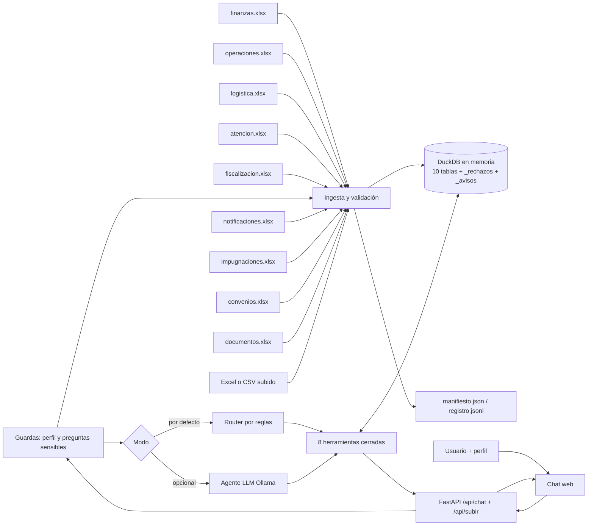

# Arquitectura

El usuario no modifica los archivos fuente originales. Los Excel/CSV subidos se guardan por separado en `data/uploads/`, se agregan al área seleccionada y permanecen tras reiniciar. La POC mantiene las diez tablas consultables en DuckDB en memoria y las reconstruye al iniciar o reimportar. Cada archivo se procesa por filas; el hash SHA-256 se calcula en bloques.

Las diez áreas son Finanzas, Operaciones, Logística, Atención, Fiscalización, Recaudación, Notificaciones, Impugnaciones, Convenios y Documentos. Las seis últimas son ejemplos sintéticos agregados para probar la integración; no representan los sistemas reales de una entidad. La consulta por reglas de las seis nuevas áreas busca registros por `id_pedido` o `id_multa` y conserva archivo, hoja y fila de procedencia. La carga autenticada acepta `.xlsx` y `.csv` de hasta 20 MB, exige las columnas definidas por el esquema y permite columnas adicionales. Cada campo vacío y cada valor no válido se reporta en `_avisos` con columna y valor original; los campos obligatorios vacíos, valores no válidos y duplicados se agregan a `_rechazos`. El endpoint autenticado `/api/calidad/descargar` genera un libro Excel con hojas independientes para rechazos y avisos. No se reemplaza una fuente al subir un archivo.

La pestaña «Consulta inteligente» incluye preguntas predefinidas para resumen por área, filas rechazadas, valores inválidos, campos vacíos y archivos cargados. El enrutador también acepta preguntas equivalentes y llama a `consultar_calidad`, con límites de acceso por perfil y hasta 100 filas de detalle por respuesta. El libro Excel de calidad descarga todos los registros por lotes.

La prueba reproducible `scripts/run_scale_test.py` genera un Excel sintético de hasta 1.048.575 filas, lo importa junto con las otras nueve áreas y mide ingesta y búsqueda por clave. Esto es una prueba local de ingesta, no una prueba de concurrencia ni una garantía de capacidad productiva.

## Interfaces

| Capa | Módulo | Contrato |
|---|---|---|
| Esquemas | `ingestion/schemas.py` | Por área: archivo, hoja, clave, columnas (tipo, obligatoriedad, patrón o vocabulario). |
| Ingesta | `ingestion/loader.py` | `Catalogo.importar()` → una tabla DuckDB por área con columnas de procedencia `_archivo, _hoja, _fila, _hash, _version, _importado_en, _modificado_en`. Lee XLSX en modo streaming y CSV por filas, y carga DuckDB desde un temporal. Campos vacíos y valores inválidos generan `_avisos`; filas inválidas/duplicadas van a `_rechazos` con su valor original. La exportación XLSX recorre los resultados por lotes y divide las hojas si alcanzan el límite de filas de Excel. |
| Herramientas | `tools/queries.py` | `ejecutar(ctx, perfil, nombre, args)` es el único acceso a datos: valida nombre y argumentos, verifica permisos y disponibilidad, y devuelve un `Resultado` (texto, tablas, fuentes, advertencias, cálculo, datos). |
| Reglas (Nivel A) | `agents/router.py` | `interpretar(pregunta, contexto)` → `Plan` con llamadas a herramientas o un mensaje fijo. |
| Agente (Nivel B) | `agents/llm.py` | Bucle de tool calling (máx. 4 llamadas). Solo recibe resultados autorizados y recortados; avisa de cifras `S/` que el modelo escriba y no estén en los resultados; si no usa herramientas, se descarta. |
| Orquestación | `agents/servicio.py` | Guardas → modo → herramientas → respuesta con `origen`, `fuentes`, `herramientas` y `contexto`. Registra sin guardar el texto de la pregunta. |
| API | `main.py` | `/api/chat`, `/api/estado`, `/api/calidad`, `/api/calidad/descargar`, `/api/reimportar`, `/api/subir`, `/api/fuente`, `/api/perfiles`, `/api/sugerencias`. |

## Herramientas

`consultar_facturas`, `consultar_entregas`, `consultar_pedido`, `consultar_cliente`, `clientes_deuda_y_reclamo`, `operaciones_vs_logistica`, `listar_inconsistencias`, `consultar_calidad`, `ver_fuente`, `consultar_area`.

Los importes se manejan como `DECIMAL(14,2)` y se suman en DuckDB, para que el valor mostrado coincida exactamente con el cálculo.

## Procedencia de cada afirmación

`origen` distingue tres cosas: **Datos de Excel** (hay fuentes), **Cálculo determinista** (hay fórmula descrita en «Cálculo y trazas») y **Reglas fijas (sin IA)** o **Redacción del modelo**. En el Nivel B, el texto del modelo se muestra separado de los «Datos verificados por las herramientas».
