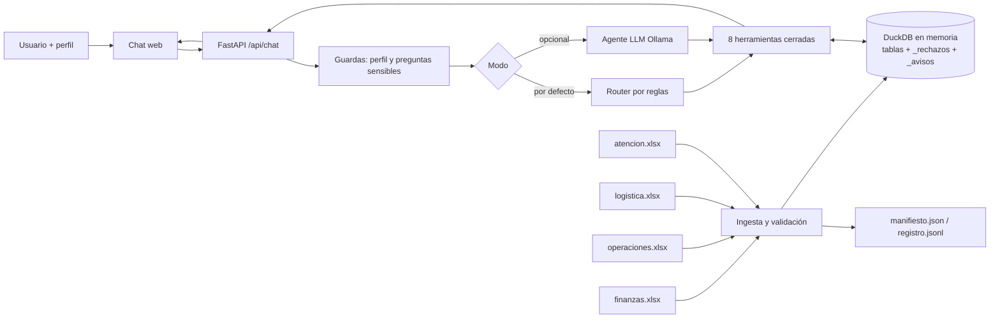

# Arquitectura

El flujo es bidireccional entre herramientas y datos; el usuario nunca toca los Excel. Los archivos se leen a memoria (SHA-256) y no se escriben.

## Interfaces

| Capa | Módulo | Contrato |
|---|---|---|
| Esquemas | `ingestion/schemas.py` | Por área: archivo, hoja, clave, columnas (tipo, obligatoriedad, patrón o vocabulario). |
| Ingesta | `ingestion/loader.py` | `Catalogo.importar()` → una tabla DuckDB por área con columnas de procedencia `_archivo, _hoja, _fila, _hash, _version, _importado_en, _modificado_en`. Filas inválidas/duplicadas van a `_rechazos` con su valor original. Un archivo roto marca solo esa área como `error`. |
| Herramientas | `tools/queries.py` | `ejecutar(ctx, perfil, nombre, args)` es el único acceso a datos: valida nombre y argumentos, verifica permisos y disponibilidad, y devuelve un `Resultado` (texto, tablas, fuentes, advertencias, cálculo, datos). |
| Reglas (Nivel A) | `agents/router.py` | `interpretar(pregunta, contexto)` → `Plan` con llamadas a herramientas o un mensaje fijo. |
| Agente (Nivel B) | `agents/llm.py` | Bucle de tool calling (máx. 4 llamadas). Solo recibe resultados autorizados y recortados; avisa de cifras `S/` que el modelo escriba y no estén en los resultados; si no usa herramientas, se descarta. |
| Orquestación | `agents/servicio.py` | Guardas → modo → herramientas → respuesta con `origen`, `fuentes`, `herramientas` y `contexto`. Registra sin guardar el texto de la pregunta. |
| API | `main.py` | `/api/chat`, `/api/estado`, `/api/calidad`, `/api/reimportar`, `/api/fuente`, `/api/perfiles`, `/api/sugerencias`. |

## Herramientas

`consultar_facturas`, `consultar_entregas`, `consultar_pedido`, `consultar_cliente`, `clientes_deuda_y_reclamo`, `operaciones_vs_logistica`, `listar_inconsistencias`, `ver_fuente`.

Los importes se manejan como `DECIMAL(14,2)` y se suman en DuckDB, para que el valor mostrado coincida exactamente con el cálculo.

## Procedencia de cada afirmación

`origen` distingue tres cosas: **Datos de Excel** (hay fuentes), **Cálculo determinista** (hay fórmula descrita en «Cálculo y trazas») y **Reglas fijas (sin IA)** o **Redacción del modelo**. En el Nivel B, el texto del modelo se muestra separado de los «Datos verificados por las herramientas».
